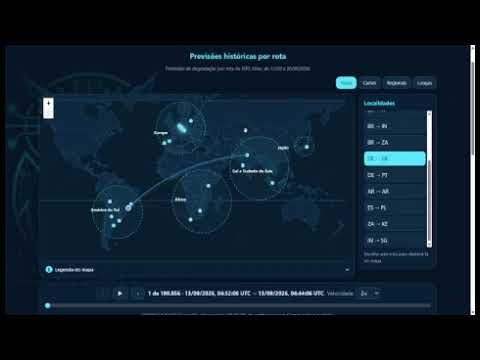

# MIRAI — Modelo Preditivo de Degradação de Rede

Projeto acadêmico do Grupo 18 de Ciência da Computação (noturno), orientado pela professora Andrea Ono Sakai. O sistema usa medições do RIPE Atlas para estudar degradação de rede e apresenta previsões históricas e medições atuais em uma interface Flask.

## Vídeo pitch

[](https://www.youtube.com/watch?v=7wiXlERGq3Y)

Assista ao pitch do projeto no YouTube: [Vídeo pitch MIRAI](https://www.youtube.com/watch?v=7wiXlERGq3Y)

## Visão geral

O repositório reúne duas partes relacionadas:

- **Pipeline de dados e experimentos:** coleta, tratamento, validação, rotulagem e treinamento documentados nos notebooks e nos documentos das tarefas.
- **Aplicação web:** classificador de medições ICMP e mapa interativo de previsões históricas, servido localmente pelo Flask.

A aplicação usa o modelo final `data_ripe_atlas/models/floresta_final.joblib`. O mapa apresenta os pings do período de 13 a 20/09/2026 em ordem cronológica, permite navegar ping a ping e reproduzir a sequência em 2×, 10× ou 15×. A previsão é para aproximadamente 12 minutos após cada medição; ela representa a classe estimada pelo modelo, não uma queda de rede confirmada.

## Estrutura do repositório

```text
.
├── app/
│   ├── static/
│   │   ├── css/                 # Estilos da interface
│   │   ├── img/                 # Logos e imagens
│   │   └── js/                  # Interação do mapa e dos controles
│   ├── templates/               # Página HTML renderizada pelo Flask
│   ├── classificador.py         # Carregamento e inferência do modelo
│   ├── configuracao.py          # Caminhos, alvos e parâmetros da aplicação
│   ├── historico.py             # Previsões históricas ping a ping
│   ├── metricas.py              # Métricas e features
│   ├── monitor.py               # Orquestra medições e classificação
│   ├── rede.py                  # Medições ICMP
│   ├── servidor.py              # Aplicação Flask e endpoints
│   └── simulacao.py             # Cenários demonstrativos sem rede
├── data/                        # Metadados auxiliares
├── data_ripe_atlas/
│   ├── config/                  # Configuração das coletas
│   ├── models/                  # Modelos e resultados do treinamento
│   ├── processed/               # Dados processados, rotulados e partições
│   └── raw/                     # Dados brutos do RIPE Atlas
├── docs/
│   ├── Artigo/                  # Artigo e figuras
│   ├── Guias/                   # Guias e materiais de apoio
│   ├── Tarefas/                 # Relatórios das tarefas acadêmicas
│   ├── dicionario_v0.1.md       # Dicionário canônico dos dados brutos
│   ├── memorando_de_decisao_grupo18.md
│   └── RFC_Preditor_Degradacao_Rede.md
├── notebook/
│   ├── arvore/                  # Experimentos e treinamento das árvores
│   ├── coletas/                 # Notebooks de coleta
│   ├── rotulagem/               # Notebook da Tarefa 2
│   └── data_ripe_atlas/         # Artefatos usados nos notebooks
├── plano/                       # Planos e configurações de coleta
├── src/                         # Utilitários de tratamento e validação
├── tests/                       # Testes de integração da aplicação
├── gerar_metricas.py            # Geração de métricas auxiliares
├── requirements.txt
└── README.md
```

## Requisitos

- Python e `pip`
- Acesso à internet para carregar o mapa-base e as bibliotecas JavaScript da interface
- Para medições atuais: conexão de rede que permita executar pings ICMP

## Instalação e execução

Na raiz do repositório, crie e ative um ambiente virtual e instale as dependências.

**Windows (PowerShell):**

```powershell
py -m venv .venv
.\.venv\Scripts\Activate.ps1
python -m pip install -r requirements.txt
```

**Linux/macOS:**

```bash
python3 -m venv .venv
source .venv/bin/activate
python -m pip install -r requirements.txt
```

Inicie a aplicação:

```bash
python -m app.servidor
```

O servidor fica disponível em <http://127.0.0.1:5000> e tenta abrir a página no navegador. Para executar sem iniciar medições ICMP, use um cenário demonstrativo:

```bash
python -m app.servidor --simular ok
python -m app.servidor --simular risco
python -m app.servidor --simular falha
```

## Interface e API

A parte de cima da página é o **preditor**: o botão **Calibrar** cria o baseline da rede que será predita e o botão **Fazer Medição** mede a rede por ICMP e mostra a classe prevista para cerca de 12 minutos depois (azul = OK, amarelo = RISCO, vermelho = FALHA), com a confiança da floresta final em cada destino. Abaixo dele fica o mapa com as previsões históricas.

O mapa permite selecionar uma rota por localidade, visualizar sua previsão e percorrer os pings históricos individualmente. O seletor de velocidade oferece 2×, 10× e 15×. A legenda explica as classes previstas, os marcadores e as linhas do mapa.

Endpoints disponíveis:

| Método | Caminho | Descrição |
|---|---|---|
| `GET` | `/` | Interface do mapa |
| `GET` | `/api/previsoes-historicas` | Resumo das previsões históricas |
| `GET` | `/api/pings-previstos?offset=0&limite=500` | Página de previsões individuais; `limite` aceita de 1 a 1000 |
| `POST` | `/api/medicao` | Mede a rede agora e devolve a previsão da floresta final (409 se a rede ainda não foi calibrada) |
| `POST` | `/api/calibracao` | Inicia a calibração (1.500 medições por alvo) em segundo plano |
| `GET` | `/api/calibracao` | Progresso e resultado da calibração |
| `DELETE` | `/api/calibracao` | Cancela a calibração em andamento sem alterar o baseline anterior |

O preditor usa os alvos configurados em `app/configuracao.py` (1.1.1.1, 8.8.8.8 e 9.9.9.9). Antes da primeira medição é preciso clicar em **Calibrar**: o sistema faz 1.500 medições por alvo (piso da RFC) e grava o "normal" da rede em `app/dados/baseline_local.json`, arquivo local que não deve ser versionado. Deixe a rede parada durante a calibração; ela pode ser cancelada e, nesse caso, o baseline anterior é mantido. Também dá para calibrar pelo terminal:

```bash
python -m app.servidor --calibrar         # 1.500 medições por alvo
```

Limitação: a floresta final foi treinada com medições espaçadas de 4 minutos. Na medição atual as 5 rodadas acontecem com poucos segundos de intervalo, então a previsão para ~12 minutos é uma aproximação.

## Dados e notebooks

Os dados processados usados na interface ficam em `data_ripe_atlas/processed/`, e o modelo final fica em `data_ripe_atlas/models/`. Os arquivos em `data_ripe_atlas/raw/` são as medições brutas; consulte os documentos em `docs/` antes de gerar novamente os dados processados.

Notebooks principais:

- Coleta inicial: `notebook/coletas/coleta_de_dados.ipynb`
- Coleta v2: `notebook/coletas/coleta_dados_v2.ipynb`
- Rotulagem e baseline: `notebook/rotulagem/tarefa2_baseline_rotulagem.ipynb`
- Árvores e modelo final: notebooks em `notebook/arvore/`

Execute os notebooks na ordem indicada pela documentação da tarefa correspondente. A interface da aplicação fica em `app/`, separada dos notebooks de experimento.

## Testes

Com o ambiente virtual ativado:

```bash
python -m pytest tests
```

Os testes cobrem o cálculo das métricas, o classificador, os endpoints Flask e o serviço dos arquivos estáticos da interface.

## Documentação do projeto

- [Memorando de decisão da fonte de dados](docs/memorando_de_decisao_grupo18.md)
- [Dicionário de variáveis brutas v0.1](docs/dicionario_v0.1.md)
- [Tarefa 1 — Coleta bruta](docs/Tarefas/Tarefa1_Coleta_Bruta.md)
- [Tarefa 2 — Baseline e rotulagem](docs/Tarefas/Tarefa2_Baseline_e_Rotulagem.md)
- [Tarefa 3 — Árvore de decisão](docs/Tarefas/Tarefa3_Arvore_de_Decisao.md)
- [Tarefa 5 — Modelo final](docs/Tarefas/Tarefa5_Arvore_Final.md)
- [RFC — Preditor de degradação de rede](docs/RFC_Preditor_Degradacao_Rede.md)
- [Guia de coleta RIPE Atlas](docs/Guias/Guia_Coleta_RIPE_Atlas.md)

## Integrantes

| Nome | RGM |
|---|---:|
| Bruno Alves Ribeiro de Souza | 42276047 |
| Samuel de Oliveira Santos | 41761782 |
| Victoria Agatha Rodrigues Fagundes | 43756042 |
| Wendel Henrique da Silva Rocha | 42614945 |
| Igor da Silva Alves Correa | 41885163 |
| Pedro Henrique Alexandre da Silva | 42947049 |

Repositório: [brunoalves2506/Modelo-preditivo---Projeto-Acad-mico---4-Semestre](https://github.com/brunoalves2506/Modelo-preditivo---Projeto-Acad-mico---4-Semestre)
